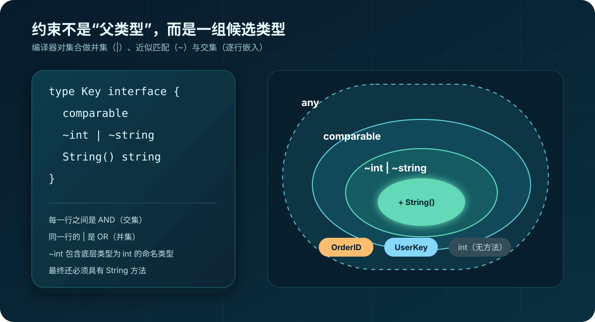
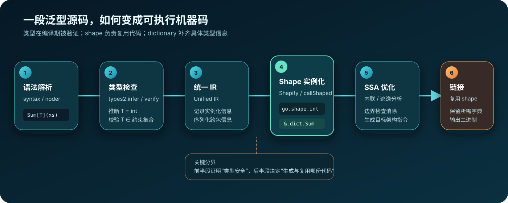
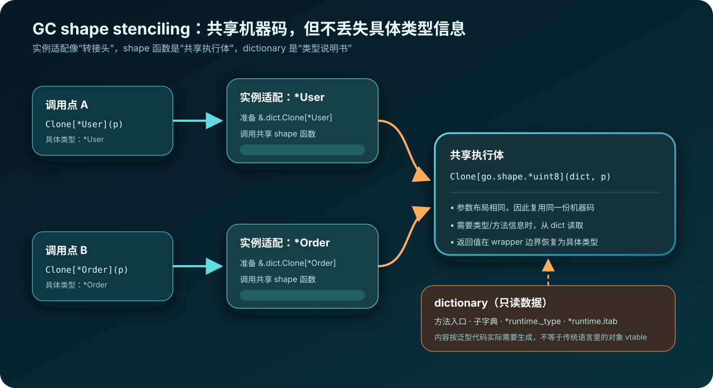

# Go 中的泛型：从会用到读懂编译器


> 本文采用“先解决重复代码，再追到编译器源码”的顺序。示例默认适用于 Go 1.21+；标有 **Go 1.27+** 的泛型方法需要更新的工具链。源码解读基于 Go 1.27.0，其他版本的文件名与行号可能变化，但 `types2 → Unified IR → shape + dictionary → SSA` 这条主线不变。

> **代码块约定：**标记为 `go` 的代码块都是一个独立、完整的 `main.go`，复制到空目录后可直接执行 `go run main.go`。标记为 `text` 的内容是故意不能编译的反例、局部源码结构或概念伪代码，不应当作为完整程序运行。

## 1. 先用一句话理解泛型

泛型让一段代码用**类型参数**表示暂时未知的类型，再用**约束**规定这个类型必须支持什么；调用时，编译器推断或接收具体类型，并在编译期检查它是否合法。

```go
package main

import "fmt"

func First[T any](xs []T) (T, bool) {
	if len(xs) == 0 {
		var zero T
		return zero, false
	}
	return xs[0], true
}

func main() {
	n, numberOK := First([]int{10, 20})
	s, stringOK := First([]string{"Go", "泛型"})
	_, emptyOK := First([]int{})

	fmt.Println(n, numberOK) // 10 true
	fmt.Println(s, stringOK) // Go true
	fmt.Println(emptyOK)     // false
}
```

把声明拆开看：

```text
func First [T any] (xs []T) (T, bool)
           └─────┘
           类型参数列表

T     类型参数：函数内部使用的类型占位符
any   类型约束：T 可以是任意类型
[]T   T 的使用位置
```

这里没有把值转换成 `interface{}`。`[]int` 进去仍然是 `[]int`，返回值仍然是 `int`，类型错误在编译期就会暴露。

---

## 2. 第一个真实问题：消除同构代码

假设要分别对 `int64` 和 `float64` 求和。没有泛型时，通常会写两份逻辑：

```go
package main

import "fmt"

func SumInt64(xs []int64) int64 {
	var sum int64
	for _, x := range xs {
		sum += x
	}
	return sum
}

func SumFloat64(xs []float64) float64 {
	var sum float64
	for _, x := range xs {
		sum += x
	}
	return sum
}

func main() {
	fmt.Println(SumInt64([]int64{1, 2, 3}))       // 6
	fmt.Println(SumFloat64([]float64{1.5, 2.25})) // 3.75
}
```

它们的算法完全相同，差异只有类型。泛型版本是：

```go
package main

import "fmt"

type Number interface {
	~int | ~int64 | ~float32 | ~float64
}

func Sum[T Number](xs []T) T {
	var sum T
	for _, x := range xs {
		sum += x
	}
	return sum
}

func main() {
	fmt.Println(Sum([]int{1, 2, 3}))       // 6
	fmt.Println(Sum([]float64{1.5, 2.25})) // 3.75
	fmt.Println(Sum[int]([]int{1, 2, 3}))  // 也可以显式指定 T
}
```

为什么约束不能只写 `any`？因为 `any` 的类型集合包含结构体、切片、函数等类型，而 `+` 并不适用于其中每一种：

```text
// 编译失败：operator + not defined on sum
func BadSum[T any](xs []T) T {
	var sum T
	for _, x := range xs {
		sum += x
	}
	return sum
}
```

编译器只允许使用**约束中所有类型都支持的操作**。这条规则是读懂约束的钥匙。

### `int` 与 `~int` 的区别

```text
type UserID int

type ExactInt interface {
	int
}

type IntLike interface {
	~int
}
```

- `int` 只包含预声明类型 `int`。
- `~int` 包含所有**底层类型为 `int`** 的类型，因此也包含 `UserID`。

所以库级约束通常使用 `~int`、`~string`，否则调用方自己定义的业务类型会被意外拒绝。

```go
package main

import "fmt"

type UserID int

type Number interface {
	~int | ~int64 | ~float32 | ~float64
}

func Sum[T Number](xs []T) T {
	var total T
	for _, value := range xs {
		total += value
	}
	return total
}

func main() {
	ids := []UserID{1001, 1002}
	fmt.Println(Sum(ids)) // 2003；因为 Number 使用了 ~int
}
```

---

## 3. 约束的本质：类型集合

传统接口从“一个值有哪些方法”理解；用作泛型约束的接口，还可以从“允许哪些类型”理解。



### 3.1 四种常用约束

| 约束 | 类型集合 | 典型用途 |
|---|---|---|
| `any` | 所有类型 | 容器、搬运值，不对值做特定运算 |
| `comparable` | 支持 `==`、`!=` 的类型 | map 的 key、Set、去重 |
| <code>~int &#124; ~string</code> | 底层类型是 `int` 或 `string` | 运算、比较、序列化边界 |
| `interface{ String() string }` | 具有指定方法的类型 | 调用类型参数的方法 |

`|` 是并集，接口中分行嵌入是交集：

```text
type StringKey interface {
	comparable       // 必须可比较
	~int | ~string   // 并且底层类型为 int 或 string
	String() string  // 并且具有 String 方法
}
```

可把它读成：

```text
StringKey = comparable ∩ (~int ∪ ~string) ∩ {具有 String() string 方法的类型}
```

### 3.2 `comparable`：写一个 Set

map 的键必须可比较，所以泛型 Set 的约束应当是 `comparable`：

```go
package main

import "fmt"

type Set[T comparable] map[T]struct{}

func NewSet[T comparable](values ...T) Set[T] {
	s := make(Set[T], len(values))
	for _, v := range values {
		s[v] = struct{}{}
	}
	return s
}

func (s Set[T]) Add(v T) {
	s[v] = struct{}{}
}

func (s Set[T]) Has(v T) bool {
	_, ok := s[v]
	return ok
}

func main() {
	users := NewSet("alice", "bob", "alice")
	users.Add("charlie")
	fmt.Println(len(users), users.Has("bob")) // 3 true
}
```

`[]byte`、`map`、`func` 不能作为这里的 `T`，编译器会直接拒绝，而不是等程序运行后再失败。

### 3.3 方法约束：对能力编程

```go
package main

import "fmt"

type Identifiable interface {
	ID() string
}

func IndexByID[T Identifiable](items []T) map[string]T {
	result := make(map[string]T, len(items))
	for _, item := range items {
		result[item.ID()] = item // 约束保证可以调用 ID
	}
	return result
}

type User struct {
	UserID   string
	UserName string
}

func (u User) ID() string { return u.UserID }

func main() {
	users := []User{
		{UserID: "u-1", UserName: "Ada"},
		{UserID: "u-2", UserName: "Rob"},
	}
	index := IndexByID(users)
	fmt.Println(index["u-2"].UserName) // Rob
}
```

这类泛型只关心“能否调用 `ID`”，不关心具体结构体是什么。与普通接口参数相比，它还能让返回值保持具体类型 `T`。

### 3.4 约束接口不一定能当变量类型

含有类型项的接口只用于约束，不能直接声明普通变量：

```text
type Integer interface {
	~int | ~int64
}

// var x Integer // 编译失败：接口包含类型约束元素，只能用于类型参数
```

而只含方法的普通接口既能约束类型参数，也能作为运行时值的类型。

---

## 4. 从函数到容器：几个最值得掌握的例子

先看一张选择表。泛型参数不是越多越好，应当从业务中真正变化的类型推出来：

| 场景 | 类型参数 | 约束为什么这样写 | 返回类型设计 |
|---|---|---|---|
| `Map` | 输入切片 `S`、元素 `E`、结果 `R` | 只搬运值，用 `any` | 返回 `[]R`，因为元素类型改变了 |
| `Filter` | 输入切片 `S`、元素 `E` | 只调用谓词，用 `any` | 返回 `S`，保留命名切片类型 |
| `Reduce` | 切片 `S`、元素 `E`、累加器 `A` | 累加规则由函数参数提供 | 返回 `A`，可与元素类型不同 |
| `Keys` | map `M`、键 `K`、值 `V` | `K` 必须 `comparable` | 返回 `[]K` |
| `Set` | 元素 `T` | 元素用作 map key | 返回或持有 `Set[T]` |
| `Cache` | 键 `K`、值 `V` | `K comparable`，`V any` | `Get` 返回 `(V, bool)` |
| `MaxBy` | 元素 `E`、排序键 `K` | `K` 必须可排序 | 空集合返回 `(E, false)` |

### 4.1 `Map`：输入和输出可以是不同类型

```go
package main

import "fmt"

func Map[S ~[]E, E, R any](src S, f func(E) R) []R {
	out := make([]R, len(src))
	for i, v := range src {
		out[i] = f(v)
	}
	return out
}

type Names []string

func main() {
	words := []string{"Go", "Generics"}
	lengths := Map(words, func(s string) int { return len(s) })
	fmt.Println(lengths) // [2 8]

	names := Names{"Ada", "Rob"}
	nameLengths := Map(names, func(s string) int { return len(s) })
	fmt.Println(nameLengths) // [3 3]
}
```

这里有三个类型参数：

- `S ~[]E`：输入是某种切片，或者底层类型为切片的命名类型。
- `E`：切片元素类型。
- `R`：映射后的结果类型。

为什么不直接写 `src []E`？`S ~[]E` 能接受并保留更多用户自定义切片类型的信息，是 Go 泛型中常见的“容器类型 + 元素类型”写法。

对于第二次调用，`S=Names, E=string, R=int`。

这次调用的推断过程是：

```text
第一个实参 names                 => S = Names
S 的约束是 ~[]E，Names 底层为 []string => E = string
第二个实参 func(string) int       => E = string，R = int
最终签名                          => func(Names, func(string) int) []int
```

调用方不需要写 `Map[Names, string, int](...)`，是因为三个参数都能从实参和约束中确定。

### 4.2 `Filter`：复用输入的命名切片类型

```go
package main

import "fmt"

func Filter[S ~[]E, E any](src S, keep func(E) bool) S {
	out := make(S, 0, len(src))
	for _, v := range src {
		if keep(v) {
			out = append(out, v)
		}
	}
	return out
}

type Scores []int

func main() {
	passed := Filter(Scores{58, 91, 73}, func(n int) bool {
		return n >= 60
	})
	fmt.Printf("%T %v\n", passed, passed) // main.Scores [91 73]
}
```

返回 `S` 而不是 `[]E`，所以命名类型 `Scores` 不会丢失。

这个选择并非总是正确。如果函数会改变切片的语义，例如把 `Meters` 映射成 `Seconds`，就不应为了“保留类型”强行返回 `S`。`Filter` 只删除元素、不改变元素含义，所以返回原切片类型是合理的。

### 4.3 泛型栈：零值也可直接使用

```go
package main

import "fmt"

type Stack[T any] struct {
	items []T
}

func (s *Stack[T]) Push(v T) {
	s.items = append(s.items, v)
}

func (s *Stack[T]) Pop() (T, bool) {
	if len(s.items) == 0 {
		var zero T
		return zero, false
	}

	i := len(s.items) - 1
	v := s.items[i]
	s.items = s.items[:i]
	return v, true
}

func main() {
	var stack Stack[string] // 零值可用
	stack.Push("first")
	stack.Push("second")
	fmt.Println(stack.Pop()) // second true
	fmt.Println(stack.Pop()) // first true
	fmt.Println(stack.Pop()) // "" false
}
```

`var zero T` 是泛型代码返回零值的标准方式。不能写 `return nil`，因为调用方可能用 `int` 实例化 `T`，而 `nil` 不是 `int`。

这个栈的几个设计点：

- `Stack[T]` 的每个实例有确定的元素类型，不需要取出后做类型断言。
- `Push` 使用指针接收者，因为它会修改 slice header。
- `Pop` 返回 `(T, bool)`，避免构造一个不一定存在的哨兵值。
- 内部切片按需扩容，`Stack[int]` 和 `Stack[string]` 的 API 完全一致。

### 4.4 `Reduce`：元素类型与聚合结果不必相同

求和只是 reduce 的一个特例。把“如何合并”作为函数参数，就不需要给元素增加运算约束：

```go
package main

import "fmt"

func Reduce[S ~[]E, E, A any](src S, initial A, merge func(A, E) A) A {
	result := initial
	for _, value := range src {
		result = merge(result, value)
	}
	return result
}

type OrderItem struct {
	Name       string
	PriceCents int64
	Count      int
}

func main() {
	items := []OrderItem{
		{Name: "book", PriceCents: 8800, Count: 1},
		{Name: "pen", PriceCents: 500, Count: 3},
	}

	total := Reduce(items, int64(0), func(sum int64, item OrderItem) int64 {
		return sum + item.PriceCents*int64(item.Count)
	})
	fmt.Println(total) // 10300
}
```

本例中：

```text
S = []OrderItem
E = OrderItem
A = int64
```

`initial` 很重要：它既提供初始值，也为编译器提供 `A` 的推断线索。若写成 `0`，无类型常量的默认类型是 `int`；这里显式写 `int64(0)`，避免把累加器推断成 `int`。

### 4.5 map 工具：同时描述容器、键和值

```go
package main

import "fmt"

func Keys[M ~map[K]V, K comparable, V any](m M) []K {
	keys := make([]K, 0, len(m))
	for key := range m {
		keys = append(keys, key)
	}
	return keys
}

type UserScores map[string]int

func main() {
	scores := UserScores{"Ada": 98, "Rob": 95}
	names := Keys(scores)
	fmt.Printf("%T %v\n", names, names) // []string；顺序不保证
}
```

为什么需要四处出现 `K`？

```text
M ~map[K]V    把容器拆出 key 和 value 类型
K comparable  满足 Go 对 map key 的语言要求
V any         本算法完全不关心 value 支持什么操作
[]K           把推断出的 key 类型带到返回值
```

如果不需要保留命名 map 类型，也可以简化为 `func Keys[K comparable, V any](m map[K]V) []K`。`M ~map[K]V` 更通用，但也更复杂，应按 API 的真实需求选择。

### 4.6 泛型并发缓存：键和值保持静态类型

```go
package main

import (
	"fmt"
	"sync"
)

type Cache[K comparable, V any] struct {
	mu   sync.RWMutex
	data map[K]V
}

func NewCache[K comparable, V any]() *Cache[K, V] {
	return &Cache[K, V]{data: make(map[K]V)}
}

func (c *Cache[K, V]) Get(key K) (V, bool) {
	c.mu.RLock()
	defer c.mu.RUnlock()
	value, ok := c.data[key]
	return value, ok
}

func (c *Cache[K, V]) Set(key K, value V) {
	c.mu.Lock()
	defer c.mu.Unlock()
	c.data[key] = value
}

type User struct {
	ID   int64
	Name string
}

func main() {
	users := NewCache[int64, User]()
	users.Set(1001, User{ID: 1001, Name: "Ada"})
	user, ok := users.Get(1001) // user 的静态类型就是 User
	fmt.Println(user.Name, ok)  // Ada true
}
```

与 `map[any]any` 相比，它有三个直接收益：

1. 写入错误类型时编译失败。
2. 读取后不需要 `value.(User)`。
3. 一个实现可以复用于 `Cache[string, []byte]`、`Cache[int64, User]` 等实例。

这里的泛型只解决类型复用，不自动解决缓存击穿、过期、容量淘汰或同 key 合并加载；这些仍是独立的并发设计问题。

### 4.7 `MaxBy`：元素本身不可排序时，提取排序键

实际业务对象通常不能直接使用 `<`。与其要求对象实现复杂接口，不如让调用方提供 key selector：

```go
package main

import (
	"cmp"
	"fmt"
)

func MaxBy[S ~[]E, E any, K cmp.Ordered](
	src S,
	key func(E) K,
) (E, bool) {
	if len(src) == 0 {
		var zero E
		return zero, false
	}

	best := src[0]
	bestKey := key(best)
	for _, value := range src[1:] {
		valueKey := key(value)
		if bestKey < valueKey {
			best = value
			bestKey = valueKey
		}
	}
	return best, true
}

type User struct {
	ID   int64
	Name string
}

func main() {
	users := []User{
		{ID: 1, Name: "Ada"},
		{ID: 9, Name: "Rob"},
	}
	latest, ok := MaxBy(users, func(user User) int64 { return user.ID })
	fmt.Println(latest.Name, ok) // Rob true
}
```

约束放在 `K` 而不是 `E` 上：`User` 不需要可排序，只要投影出来的 `ID` 可排序即可。`cmp.Ordered` 来自标准库 `cmp` 包，包括有序的整数、浮点数和字符串类型及其底层类型相同的命名类型。

### 4.8 进阶：当方法只定义在 `*T` 上

有时需要在泛型函数里创建 `T`，再调用 `*T` 的方法。只写一个 `T` 很难同时表达“值类型”和“它的指针具有某方法”，可以使用第二个类型参数：

```go
package main

import (
	"fmt"
	"strconv"
)

type Settable interface {
	Set(string) error
}

func ParseAll[T any, PT interface {
	*T
	Settable
}](texts []string) ([]T, error) {
	result := make([]T, 0, len(texts))
	for _, text := range texts {
		var value T
		pointer := PT(&value)
		if err := pointer.Set(text); err != nil {
			return nil, err
		}
		result = append(result, value)
	}
	return result, nil
}

type Port int

func (p *Port) Set(text string) error {
	n, err := strconv.Atoi(text)
	if err != nil {
		return err
	}
	*p = Port(n)
	return nil
}

func main() {
	ports, err := ParseAll[Port]([]string{"80", "443"})
	// T=Port；约束中的 *T 让编译器继续推断 PT=*Port
	fmt.Println(ports, err) // [80 443] <nil>
}
```

逐项解释 `PT` 的约束：

- `*T`：`PT` 的类型集合只能包含指向 `T` 的指针类型。
- `Settable`：这个指针还必须有 `Set(string) error` 方法。
- `PT(&value)`：因为约束保证表示兼容，所以可把 `*T` 转为 `PT`。

这是很有用但认知成本较高的模式。普通构造函数或非泛型解析器已经足够时，不必强行使用它。

### 4.9 标准库优先：排序不必自己造轮子

Go 标准库的 `slices`、`maps`、`cmp` 已经提供了大量泛型能力：

```go
package main

import (
	"fmt"
	"slices"
)

func main() {
	nums := []int{64, 34, 25, 12}
	words := []string{"banana", "apple", "orange"}

	slices.Sort(nums)
	slices.Sort(words)

	fmt.Println(nums)  // [12 25 34 64]
	fmt.Println(words) // [apple banana orange]
}
```

工程中先找标准库，再考虑写通用算法；泛型的价值是复用清晰的算法，不是把每段代码都抽象成模板。

---

## 5. 类型推断：为什么调用时常常不用写 `[int]`

```go
package main

import "fmt"

func Pair[A, B any](a A, b B) (A, B) {
	return a, b
}

func main() {
	x, y := Pair(10, "Go") // 推断 A=int，B=string
	fmt.Printf("%T(%v), %T(%v)\n", x, x, y, y)

	a, b := Pair[int](20, "泛型") // A 显式指定，B 继续推断
	fmt.Printf("%T(%v), %T(%v)\n", a, a, b, b)
}
```

编译器把实参类型与形参中出现的类型参数做统一（unification）：

```text
形参 A  ← 实参 10 的默认类型 int     => A = int
形参 B  ← 实参 "Go" 的类型 string    => B = string
```

显式类型参数可以只写前面一部分，剩余部分继续推断：

上面的 `Pair[int](20, "泛型")` 显式指定了 `A=int`，`B` 仍由第二个实参推断为 `string`。

### 推断失败的典型情况

类型参数只出现在返回值里时，调用参数无法提供线索：

```go
package main

import "fmt"

func Zero[T any]() T {
	var zero T
	return zero
}

func main() {
	// n := Zero() // 故意取消注释会编译失败：无法推断 T
	n := Zero[int]() // 必须显式指定
	s := Zero[string]()
	fmt.Printf("%d %q\n", n, s) // 0 ""
}
```

不要把类型推断理解成运行时反射。`T` 在类型检查阶段就已经确定；若确定不了，代码不能通过编译。

---

## 6. 泛型类型、方法，以及 Go 1.27 的泛型方法

### 6.1 泛型类型的方法

从 Go 1.18 起，泛型类型可以有使用接收者类型参数的方法：

```go
package main

import "fmt"

type Box[T any] struct {
	value T
}

func (b Box[T]) Get() T {
	return b.value
}

func (b *Box[T]) Set(v T) {
	b.value = v
}

func main() {
	box := Box[int]{value: 10}
	fmt.Println(box.Get()) // 10
	box.Set(20)
	fmt.Println(box.Get()) // 20
}
```

这里的 `Get`、`Set` 本身没有声明新的类型参数；`T` 来自接收者 `Box[T]`。

### 6.2 Go 1.27+：方法可以声明自己的类型参数

Go 1.27 新增了泛型方法。它可以在接收者的类型参数之外再声明新参数：

```go
package main

import "fmt"

type List[E any] []E

// Go 1.27+
func (list List[E]) Apply[R any](f func(E) R) List[R] {
	result := make(List[R], len(list))
	for i, value := range list {
		result[i] = f(value)
	}
	return result
}

func main() {
	lengths := List[string]{"Go", "Generics"}.Apply(
		func(s string) int { return len(s) },
	)
	fmt.Println(lengths) // [2 8]
}
```

若项目的 `go.mod` 仍是较早语言版本，这段代码会被拒绝。兼容旧版本时继续使用普通泛型函数：

```go
package main

import "fmt"

type List[E any] []E

func Apply[E, R any](list List[E], f func(E) R) List[R] {
	result := make(List[R], len(list))
	for i, value := range list {
		result[i] = f(value)
	}
	return result
}

func main() {
	lengths := Apply(List[string]{"Go", "Generics"}, func(s string) int {
		return len(s)
	})
	fmt.Println(lengths) // [2 8]
}
```

---

## 7. 容易踩的坑

### 7.1 不要假设 `T` 能与 `nil` 比较

```text
// 错误：T 可能是 int
func IsNil[T any](v T) bool {
	return v == nil
}
```

如果业务真的围绕 nil，应使用更精确的约束或重新设计 API；很多时候返回 `(T, bool)` 更自然。

### 7.2 不能直接对类型参数做 type switch

先转成接口值：

```go
package main

import "fmt"

func Kind[T any](v T) string {
	switch any(v).(type) {
	case int:
		return "int"
	case string:
		return "string"
	default:
		return "other"
	}
}

func main() {
	fmt.Println(Kind(10))       // int
	fmt.Println(Kind("Go"))     // string
	fmt.Println(Kind([]int{1})) // other
}
```

但大量 type switch 往往说明算法并不真正通用；可能普通接口、不同函数或方法分派更清楚。

### 7.3 指针接收者与约束的方法集

```go
package main

import "fmt"

type Stringer interface {
	String() string
}

type User struct{ Name string }

func (u *User) String() string { return u.Name }

func Print[T Stringer](v T) {
	fmt.Println(v.String())
}

func main() {
	// Print(User{}) // 故意取消注释会失败：String 在 *User 的方法集中
	Print(&User{Name: "Ada"})
}
```

泛型没有改变 Go 原有的方法集规则。遇到约束不满足时，先看传入的是 `T` 还是 `*T`。

### 7.4 泛型实例之间没有协变关系

即使 `Dog` 满足 `Animal`，`Box[Dog]` 也不是 `Box[Animal]`。Go 不会自动把一个泛型实例转换成另一个实例；需要显式遍历转换。

### 7.5 不要为了“看起来高级”而泛型化

适合泛型的场景：

- 切片、map、树、队列、集合等容器。
- 算法只依赖少量明确操作，如比较、排序、聚合。
- 多份代码结构相同，区别主要是类型。

通常不值得使用的场景：

- 只有一个实际类型。
- 不同类型虽然函数名相同，业务语义却不同。
- 约束复杂到比重复的具体实现更难读。
- 只需要调用一个方法，普通接口已经足够，且不需要保留具体返回类型。

经验法则：先写清楚的具体代码，重复模式稳定后再提取泛型。

---

## 8. 实现原理：Go 不是简单的“全量单态化”

常见泛型实现策略有两种极端：

| 策略 | 做法 | 优点 | 代价 |
|---|---|---|---|
| 全量单态化（monomorphization） | 每组类型参数复制一份机器码 | 容易做针对具体类型的优化 | 二进制容易膨胀 |
| 装箱 + 虚调用 | 所有类型走统一表示和方法表 | 代码体积小 | 可能有装箱、间接调用成本 |

Go 编译器采用折中方案：**GC shape stenciling + dictionary**。

1. 按类型的底层表示生成或复用 **shape 函数**。
2. 给 shape 函数增加一个隐藏的 **dictionary 指针**。
3. dictionary 提供具体类型的方法入口、运行时类型描述等信息。
4. 直接调用点可把字典传给 shape 函数；需要保留具体函数值或适配 ABI 时，编译器再生成很薄的 wrapper。



### 8.1 什么是 GC shape

shape 是编译器内部用于决定“哪些实例可以共用机器码”的类型。

以 Go 1.27 的 `noder.Shapify` 为例：

- 一般类型使用它的底层类型作为 shape。
- 在约束允许的情况下，普通指针类型会折叠为类似 `go.shape.*uint8` 的公共形状。
- 当前实现不会简单地把所有大小、对齐相同的标量都合并；源码里仍把更激进的 shape 合并列为可优化方向。

例如：

```text
func Clone[T any](p T) T { return p }

type User struct{ Name string }
type Order struct{ ID int }

u := &User{Name: "Ada"}
o := &Order{ID: 42}

_ = Clone(u) // T = *User
_ = Clone(o) // T = *Order
```

`*User` 与 `*Order` 的值在机器层面都是指针，并且这里的算法不关心指向对象的布局，因此编译器有机会让它们共用指针 shape 的执行体。

### 8.2 dictionary 里有什么

不要把 dictionary 简单等同于 C++ vtable。根据 Go 1.27 的 `readerDict`/`writerDict`，运行时字典按需包含四类条目：

```text
dictionary
├── typeParamMethodExprs  类型参数的方法入口
├── subdicts              嵌套调用其他泛型实例所需的子字典
├── rtypes                *runtime._type，具体类型描述
└── itabs                 具体类型到接口的 *runtime.itab
```

泛型函数没有用到某类能力时，对应条目不需要出现。因此 dictionary 是由编译器根据函数体实际需求生成的只读数据。



可用近似伪代码理解编译结果：

```text
// 源码
result := Clone[*User](user)

// 概念上的 wrapper，不是用户可调用的 Go 源码
func Clone_User(user *User) *User {
	return Clone_PointerShape(&dict_Clone_User, user)
}

// 多种普通指针实例共享的执行体
func Clone_PointerShape(dict *Dictionary, value unsafe.Pointer) unsafe.Pointer {
	return value
}
```

真实 IR 和 ABI 比这个伪代码复杂；编译器也可能把适配直接放在调用点。核心结构是“具体类型适配 + 隐藏字典 + 共享 shape 体”。

### 8.3 为什么既要 shape，又要 dictionary

只共享机器码会丢失具体类型信息。考虑一个需要调用方法的函数：

```text
type Named interface {
	Name() string
}

func NameOf[T Named](v T) string {
	return v.Name()
}
```

编译 shape 函数时，`T` 还不是某个具体结构体，无法把 `v.Name()` 永远绑定到同一个方法地址。dictionary 提供该实例对应的方法入口，shape 函数通过它完成调用。

反过来，如果为每个 `T` 都复制完整函数体，就不需要很多间接信息，但代码体积会增长。shape 与 dictionary 的配合是在性能、编译速度、二进制大小之间做平衡。

---

## 9. 源码解读：跟一次 `Sum([]int{...})` 的编译过程

下面按实际编译阶段阅读 Go 1.27 源码。建议不要从某一个函数硬啃到底，而是沿数据流定位。

先建立源码地图：

| 阶段 | 输入 | 关键包/文件 | 关键函数或结构 | 输出 |
|---|---|---|---|---|
| 语法解析 | `Sum[T Number]` 源码 | `syntax/parser.go` | 类型参数列表、索引表达式解析 | syntax AST |
| 类型集合 | `Number` 接口 | `types2/union.go`、`types2/typeset.go` | `Union`、`Term`、`_TypeSet` | 可计算的约束集合 |
| 调用推断 | `Sum([]int{...})` | `types2/call.go`、`types2/infer.go` | `funcInst`、`infer`、`unifier` | `targs=[int]` |
| 类型实例化 | 泛型签名 + `targs` | `types2/instantiate.go`、`subst.go` | `instance`、`verify`、`subst` | `func([]int) int` |
| Unified IR 写入 | 已类型检查 AST | `noder/writer.go` | `writerDict`、`funcInst` | 跨包可实例化的数据 |
| Shape 构造 | `int` 等具体类型 | `noder/reader.go` | `Shapify`、`objDictIdx` | `go.shape.int` 等内部类型 |
| 调用降级 | 泛型调用表达式 | `noder/reader.go` | `funcInst`、`callShaped`、`shapeSig` | shape 调用 + 隐藏字典参数 |
| 后端优化 | 编译器 IR | `ssa`、`ssagen` | 内联、逃逸、代码生成 | 目标文件 |
| 链接 | 各包目标文件 | `cmd/link` | 可达性与符号链接 | 原生二进制 |

在本机源码中定位这些入口：

```bash
go_src=$(go env GOROOT)

rg -n 'func \(check \*Checker\) infer|func \(check \*Checker\) verify' \
  "$go_src/src/cmd/compile/internal/types2"

rg -n 'func Shapify|func shapeSig|func .*dictNameOf|func .*callShaped' \
  "$go_src/src/cmd/compile/internal/noder"
```

先用 `rg` 找函数，再只阅读相邻几十行，比从目录第一行顺序读到最后更容易建立调用关系。

贯穿本节的调用是：

```text
type Number interface {
	~int | ~int64 | ~float32 | ~float64
}

func Sum[T Number](values []T) T {
	var total T
	for _, value := range values {
		total += value
	}
	return total
}

answer := Sum([]int{1, 2, 3})
```

编译器中几组容易混淆的名词：

| 名词 | 本例 | 所在阶段 | 含义 |
|---|---|---|---|
| type parameter | `T` | 声明/类型检查 | 未知类型的形参 |
| type argument | `int` | 调用/实例化 | 代入 `T` 的具体类型 |
| constraint | `Number` | 类型检查 | `T` 必须满足的类型集合 |
| instance | `Sum[int]` | 类型检查与 IR | 泛型对象与类型实参的组合 |
| shape | `go.shape.int` | 代码生成 | 用于选择共享函数体的内部类型 |
| dictionary | `.dict.Sum[int]` | IR/目标文件 | shape 函数需要的具体类型元数据 |

### 阶段 1：解析类型参数和类型集合

关键目录：

```text
src/cmd/compile/internal/syntax/     语法树
src/cmd/compile/internal/types2/     编译器使用的类型检查器
```

重点文件：

- [`types2/union.go`](https://go.dev/src/cmd/compile/internal/types2/union.go)：把 `~int | ~float64` 解析为 `Union` 和 `Term`。
- [`types2/typeset.go`](https://go.dev/src/cmd/compile/internal/types2/typeset.go)：计算接口的类型集合。
- [`types2/interface.go`](https://go.dev/src/cmd/compile/internal/types2/interface.go)：接口类型及其延迟计算的 type set。

`_TypeSet` 的核心字段可以概括为：

```text
type _TypeSet struct {
	methods    []*Func
	terms      termlist
	comparable bool
}
```

源码注释给出的关系非常重要：最终类型集合是**方法要求、类型项和 comparable 条件的交集**。这正是为什么约束中每增加一行，候选类型只会更少。

#### 1.1 `~int | ~int64` 如何进入编译器

`union.go` 的主线是：

```text
语法表达式 ~int | ~int64
        ↓ flattenUnion
拆成两个语法项：~int、~int64
        ↓ parseTilde
Term{tilde:true, typ:int}
Term{tilde:true, typ:int64}
        ↓ NewUnion / parseUnion
Union{terms:[...]}
```

`Term` 只需要表达两个信息：

```text
type term struct {
	tilde bool // 是否带 ~
	typ   Type // int、int64 等类型
}
```

解析之后还会检查：

- `~` 后面不能是接口。
- `~T` 中的 `T` 自己必须就是底层类型。
- 一个 union 中的非接口类型项不能重叠，例如 `int | ~int` 非法。
- Go 1.27 的实现仍限制一个 union 最多处理 100 个 term；正常约束远不应接近这个数量。

#### 1.2 union 是并集，接口元素之间是交集

对下面的约束：

```text
type SignedText interface {
	~int | ~int64
	String() string
}
```

可以把计算过程写成：

```text
unionTerms = 𝕌(~int) ∪ 𝕌(~int64)
methodSet  = {所有具有 String() string 的类型}
result     = unionTerms ∩ methodSet
```

在 `typeset.go` 中：

- `computeUnionTypeSet` 负责 union 内部的并集。
- `computeInterfaceTypeSet` 遍历接口元素。
- `intersectTermLists` 把每个接口元素的 term list 逐步求交集。
- 方法单独收集到 `_TypeSet.methods`，`comparable` 单独保存在布尔字段中。

所以 `_TypeSet` 不是把宇宙中的所有 Go 类型真的枚举出来，而是用“方法 + 规范化的 term 列表 + comparable 标记”表示集合。

#### 1.3 操作符为何能通过约束检查

当编译器看到 `total += value` 时，它不是等到 `T=int` 才决定语法是否合法。泛型函数体在声明处就要能够独立完成类型检查：约束 `Number` 的每个类型项都支持 `+`，且结果仍可赋给 `T`，因此操作合法。

若约束写成：

```text
type BadNumber interface {
	~int | ~[]byte
}
```

`+` 并非类型集合中每个成员的公共操作，函数声明本身就会报错。这是 Go 泛型与“运行时根据类型选择分支”最根本的区别。

### 阶段 2：推断类型参数

入口集中在：

- [`types2/call.go`](https://go.dev/src/cmd/compile/internal/types2/call.go) 的 `funcInst`。
- [`types2/infer.go`](https://go.dev/src/cmd/compile/internal/types2/infer.go) 的 `infer`。

对于：

```text
Sum([]int{1, 2, 3})
```

大致过程是：

```text
读取显式类型实参：无
        ↓
发现 Sum 有类型参数 T
        ↓
把形参 []T 与实参 []int 做统一
        ↓
得到 T = int
        ↓
实例化函数签名：func([]int) int
```

`call.go` 中的 `instantiateSignature` 会调用实例化逻辑，并记录这次 instance，之后再校验类型参数是否满足约束。

Go 1.21 起还支持反向类型推断，例如把泛型函数赋给一个已知函数类型；`infer.go` 中的 `enableReverseTypeInference` 和相邻逻辑就是入口。

#### 2.1 `funcInst` 看到的内部状态

进入 `types2.call.go:funcInst` 时，可把关键变量理解为：

| 变量 | `Sum([]int{1,2,3})` 中的值 | 用途 |
|---|---|---|
| `sig.TypeParams()` | `[T Number]` | 尚未实例化的类型参数 |
| `inst` | `nil` | 源码没有显式 `[int]` |
| `targs` | 起初为空 | 已知或正在推断的类型实参 |
| `params` | `([]T)` | 泛型函数形参 |
| `args` | `([]int)` | 调用点实参 |

`funcInst` 先检查显式类型实参数量。若 `got < want` 且当前允许推断，就复制/重命名类型参数后调用 `infer`；推断结束必须满足 `got == want`，然后才进入 `instantiateSignature`。

#### 2.2 `infer` 并非猜测，而是统一方程

这次调用只有一个核心方程：

```text
[]T  ≡  []int
```

unifier 递归比较两边结构：

```text
两边都是 slice
    ↓ 比较元素
T ≡ int
    ↓ T 尚未绑定
记录 T → int
```

更复杂的 `Map(names, mapper)` 会形成多个方程：

```text
S          ≡ Names
func(E) R  ≡ func(string) int
S 的 core type ≈ []E
```

经过实参统一和约束 core type 推导后，得到 `S=Names, E=string, R=int`。`infer.go` 中的 `coreTerm` 就用于从约束中提取唯一的核心结构，例如从 `S ~[]E` 看到 slice 结构。

#### 2.3 无类型常量何时默认化

对于：

```text
func Same[T any](a, b T) T { return a }

Same(1, 2)       // T=int
Same(1, 2.5)     // T=float64
```

`1`、`2.5` 最初是 untyped constant。推断器会先收集它们给同一个 `T` 的信息，再选择能表示所有实参的默认类型。`untyped nil` 没有默认类型，因此单靠 `nil` 往往无法推断：

```text
func Use[T any](*T) {}

// Use(nil)       // 无法推断 T
Use[int](nil)     // 显式给出 T
```

#### 2.4 反向类型推断

Go 1.21+ 还可从目标函数类型反推：

```text
func Identity[T any](value T) T { return value }

var intIdentity func(int) int = Identity // 从左侧推断 T=int
```

`funcInst` 会把这次赋值概念化为一个合成调用，让目标签名也参与统一。源码中的 `reverse` 标记主要用于把错误信息的方向调整得更符合用户阅读习惯。

### 阶段 3：替换类型参数并校验约束

重点文件：

- [`types2/instantiate.go`](https://go.dev/src/cmd/compile/internal/types2/instantiate.go)：`Instantiate`、`instance`。
- [`types2/subst.go`](https://go.dev/src/cmd/compile/internal/types2/subst.go)：用类型实参替换类型参数。
- [`types2/mono.go`](https://go.dev/src/cmd/compile/internal/types2/mono.go)：检测无法静态收敛的递归实例化循环。

`Instantiate` 接受原始泛型类型和 `targs`。启用校验时，它会确认：

1. 原对象确实是泛型函数、泛型命名类型或泛型别名。
2. 类型实参与类型参数数量一致。
3. 每个类型实参满足对应约束。
4. 相同实例如果已存在，尽量从 context 中复用。

注意这里的“实例化类型”仍然主要服务于类型检查；真正决定机器码如何复用的是后面的 shape 实例化。

#### 3.1 `instantiateSignature` 做了什么

`call.go` 中的主干顺序可简化为：

```text
infer 得到完整 targs
        ↓
check.instance(originSignature, targs)
        ↓
用 subst 将签名里的 T 替换成 int
        ↓
recordInstance(expr, targs, instantiatedSignature)
        ↓
later: verify(int satisfies Number)
```

得到的函数签名从：

```text
func[T Number]([]T) T
```

变成：

```text
func([]int) int
```

替换不仅作用于顶层参数。若原类型是 `map[string][]*T`，实例化 `T=User` 后，`subst.go` 会递归构造 `map[string][]*User`。

#### 3.2 为什么有实例缓存

`instantiate.go:instance` 会为“泛型原对象 + 类型实参”计算 identity/hash，并查询 `Context`：

```text
(origin=Box, targs=[int]) ──hash──> instance key
                                   ├─ 已存在：复用 *Named
                                   └─ 不存在：创建并登记
```

这样同一次类型检查过程中多次出现 `Box[int]` 时，不必反复展开等价类型，也有助于维持递归命名类型的引用关系。

#### 3.3 `verify` 检查的不是字符串相等

对 `T Number`、`T=int`，`verify` 最终要证明 `int` 满足 `Number`。证明内容包括：

- 类型实参属于约束 term 表示的集合。
- 具有约束要求的全部方法。
- 若约束包含 `comparable`，则满足相应可比较规则。
- 类型实参中若仍包含其他类型参数，要在替换后的上下文中继续判断。

因此错误信息能指出“哪个类型实参不满足哪个约束”，而不只是笼统地报告实例化失败。

#### 3.4 `mono.go` 防止实例无限增长

下面这种模式会让静态实例类型不断变大：

```text
func Grow[T any]() {
	Grow[[]T]()
}
```

实例序列是 `Grow[int] → Grow[[]int] → Grow[[][]int] → ...`，永远不能达到固定点。`mono.go` 建立类型参数依赖图，检测这种 unbounded recursive instantiation；否则采用静态实例化的编译器可能永远编译不完。

### 阶段 4：Unified IR 记录跨包实例化信息

重点文件：

- [`noder/writer.go`](https://go.dev/src/cmd/compile/internal/noder/writer.go)：写入统一 IR 与字典需求。
- [`noder/reader.go`](https://go.dev/src/cmd/compile/internal/noder/reader.go)：读取、实例化并构造编译器 IR。

`writerDict` 会收集：

- 隐式、接收者和显式类型参数。
- 依赖类型参数的派生类型。
- 类型参数的方法表达式。
- 子字典、运行时类型和 itab。

跨包泛型之所以可行，是因为导出数据不只保存一个已经编译死的函数，也保留了下游实例化需要的结构化信息。

#### 4.1 为什么实例化主要发生在使用方

假设包 `mathx` 声明 `Sum[T]`，包 `main` 调用 `mathx.Sum([]int{...})`。`mathx` 自己无法预知未来所有调用方会传哪些类型，因此它的导出数据要包含足够的信息，让 `main` 编译时能构造所需实例。

```text
mathx 源码
   ↓ 类型检查 / writer
导出数据：泛型声明、函数体信息、字典需求
   ↓ main 导入 / reader
发现 Sum[int]
   ↓
构造 shape 实体与 .dict.Sum[int]
```

Unified IR 解决的正是“跨包保留可实例化表示”的问题。这里的 `noder` 名称带有历史色彩；当前它不仅负责传统意义上的语法节点转换，也承担统一 IR 的读写和泛型实例化工作。

#### 4.2 `writerDict` 的字段分别解决什么问题

| 字段 | 什么时候需要 | 示例 |
|---|---|---|
| `implicits` | 泛型声明捕获外层类型参数 | 泛型函数体内声明局部泛型类型 |
| `receivers` | 泛型类型的方法使用接收者参数 | `func (b Box[T]) Get() T` |
| `derived` | 构造依赖类型参数的新类型 | `[]T`、`map[string]*T` |
| `typeParamMethodExprs` | 调用类型参数的方法 | `value.String()` |
| `subdicts` | 当前泛型函数再调用其他泛型对象 | `Outer[T]` 调 `Inner[T]` |
| `rtypes` | 需要具体运行时类型描述 | 转接口、反射相关操作 |
| `itabs` | 具体类型要转换成非空接口 | `T` 转为某个方法接口 |

`writer.go:funcInst` 还区分两种情况：

```text
类型实参全部静态已知
    → 记录被调用对象，后续可直接引用静态 dictionary

类型实参依赖当前函数的 T
    → 记录 subdictionary 索引，运行时从当前 dictionary 取下一级 dictionary
```

例如：

```text
func Inner[T any](value T) T { return value }

func Outer[T any](value T) T {
	return Inner(value) // Inner 的类型实参依赖 Outer 的 T
}
```

编译 `Outer[go.shape.X]` 时并不知道所有具体 `T`，但当前 dictionary 可以携带 `Inner[T]` 对应的子字典。

### 阶段 5：`Shapify` 选择共享形状

`noder/reader.go` 中的 `Shapify(targ, basic)` 是最值得亲手读的函数之一。它的主干可概括为：

```text
如果是适合合并的普通指针
    shape = *uint8
否则
    shape = targ 的底层类型
```

这解释了符号表中的 `go.shape.int`、`go.shape.string`、`go.shape.*uint8` 等名字。

#### 5.1 `basic` 参数决定指针能否合并

`Shapify(targ, basic)` 中的 `basic` 不是“基础类型”的意思，而是指类型参数的约束是否是 basic interface（完全由方法集描述的接口，例如 `any`）。

当 `basic=true` 且类型实参是普通指针时，具体元素布局不影响泛型函数体可执行的操作，所以源码选择 `*uint8` 作为公共 shape。这个 `*uint8` 只是内部代表，不表示编译器真的把业务指针转换成 `*byte` 后让用户访问。

#### 5.2 常见类型与 shape 的关系

以下是理解规则的近似表，最终以对应 Go 版本的 `Shapify` 和编译产物为准：

| 类型实参 | 常见内部 shape | 是否可能与其他类型共享函数体 |
|---|---|---|
| `int`、`type UserID int` | `go.shape.int` | 底层类型相同者可共享 |
| `string`、`type Name string` | `go.shape.string` | 底层类型相同者可共享 |
| `*User`、`*Order`，约束为 `any` | `go.shape.*uint8` | 普通指针之间可共享 |
| `[]int` | 与 `[]int` 底层表示相关的 shape | 与 shape 相同实例共享 |
| 不同字段布局的结构体 | 各自底层结构 shape | 通常不共享 |

Go 1.27 源码中的 TODO 明确提到未来可能更激进地合并相同大小/对齐的标量、递归处理复合类型、忽略结构体字段名和 tag。因此 shape 是实现细节，不能作为业务程序依赖的稳定 ABI。

#### 5.3 shape 与类型检查 instance 是两层概念

```text
类型检查层：UserID 和 int 是不同的命名类型/类型实参
                         ↓ Shapify
代码生成层：二者可能映射到同一个 go.shape.int 执行体
                         ↓ dictionary
需要时仍能区分 UserID 与 int 的具体类型元数据
```

共享 shape 不会让两个 Go 类型变成同一类型；赋值规则、方法集和反射身份仍遵守语言规范。

### 阶段 6：生成 dictionary 和 wrapper

仍在 `noder/reader.go`：

- `dictNameOf`：创建运行时 dictionary 符号并依次写入方法、子字典、`rtype`、`itab`。
- `shapeSig`：复制原函数签名，在参数列表前插入隐藏的 dictionary 指针，并把签名标记为 shaped。
- `callShaped`：让需要实体的非 shape 实例构造 dictionary 参数，尾调用 shape 版本；静态直接调用也可能直接传字典。
- `funcInst`：为实例化函数解析 wrapper、shape 函数和 dictionary 指针。

`shapeSig` 最关键的动作可以抽象为：

```text
params := make([]*Field, 1+originalParamCount)
params[0] = dictionaryPointer
copy(params[1:], originalParams)
```

也就是说，dictionary 不是 Go 源码签名的一部分，却真实存在于编译器内部签名和调用约定中。

#### 6.1 dictionary 的实际字布局

`reader.go:dictNameOf` 按固定区段把条目写入只读符号。按源码中的 offset 函数，布局可表示为：

```text
word 0
┌──────────────────────────────┐
│ typeParamMethodExprs         │ 长度 = 方法表达式数量
├──────────────────────────────┤ ← subdictsOffset
│ subdict pointers             │ 长度 = 子字典数量
├──────────────────────────────┤ ← rtypesOffset
│ *runtime._type pointers      │ 长度 = rtype 数量
├──────────────────────────────┤ ← itabsOffset
│ *runtime.itab pointers       │ 长度 = itab 数量
└──────────────────────────────┘
总字数 = itabsOffset + len(itabs)
```

源码中的关系是：

```text
typeParamMethodExprsOffset = 0
subdictsOffset             = methodExprsOffset + len(methodExprs)
rtypesOffset               = subdictsOffset + len(subdicts)
itabsOffset                = rtypesOffset + len(rtypes)
```

`varType()` 最终把 dictionary 表示为 `[N]uintptr`，shape 函数接收指向这个数组的隐藏指针。具体槽位解释完全由编译器生成的代码掌握，用户代码无法也不应该访问它。

#### 6.2 方法调用怎样使用字典

对于：

```text
func StringOf[T fmt.Stringer](value T) string {
	return value.String()
}
```

概念上的降级过程是：

```text
StringOf[Concrete](value)
        ↓
StringOf[go.shape.X](&.dict.StringOf[Concrete], value)
        ↓
从 dict 的 typeParamMethodExprs 区取 String 方法入口
        ↓
间接调用 Concrete.String(value)
```

这也是源码中 `devirtualize` 对 shape 调用较谨慎的原因：如果方法地址来自 dictionary，编译器未必能像普通静态方法调用那样直接去虚化。

#### 6.3 类型转换怎样使用 `rtype` 和 `itab`

当泛型函数把 `T` 转为接口时，shape 只知道值的表示，不知道具体动态类型：

```text
func AsAny[T any](value T) any {
	return value
}
```

构造接口值需要具体类型的 `*runtime._type`；转换为有方法的接口还可能需要 `*runtime.itab`。这些指针在编译实例时写入 dictionary，shape 函数按索引取出。

#### 6.4 三种调用形态

| 调用形态 | 字典来源 | 是否一定需要独立 wrapper |
|---|---|---|
| 具体直接调用 `F[int](x)` | 静态 `.dict.F[int]` | 不一定；可直接调用 shape |
| 泛型函数内调用 `F[T](x)` | 当前字典中的 subdict | 不一定；动态取子字典后调用 shape |
| 把 `F[int]` 当函数值传递 | 要把具体字典“绑定”进去 | 常需要 wrapper/closure 维持普通 Go 函数签名 |

这解释了为什么 `go tool nm` 有时只看到 shape 和 dictionary，看不到每个具体类型对应的 wrapper：直接调用路径不需要把所有 wrapper 都实体化。

### 阶段 7：进入 SSA、生成机器码并链接

shape 函数进入普通编译流水线后，与其他函数一样接受：

- 内联与去虚化。
- 逃逸分析。
- 边界检查消除。
- SSA 优化与目标架构代码生成。

链接器只保留最终可达的实例、shape 与 dictionary。泛型不是解释执行，也不是程序启动时再编译；最终仍是原生机器码。

#### 7.1 shape 函数仍能参与普通优化

dictionary 参数的存在不代表所有操作都要查表。`Sum[go.shape.int]` 中的 `+` 已经对应整数加法，循环也能像普通函数一样进入 SSA。只有真正依赖具体类型身份或方法地址的操作才需要读取 dictionary。

#### 7.2 内联会让符号“消失”

一个很小的泛型函数可能被内联到调用方，随后常量传播或死代码消除又删掉中间结果。此时符号表未必保留你预期的 shape 函数。源码实验通常要同时使用：

```text
//go:noinline
func Clone[T any](value T) T { return value }
```

以及：

```bash
go build -gcflags='all=-l' .
```

#### 7.3 二进制大小取决于“不同 shape 数”，不只取决于实例数

假设调用 `Clone` 的具体类型有 100 个：若它们大部分是可合并的普通指针，可能只需要少量共享 shape 函数，但仍有多份小 dictionary；若它们是 100 种不同结构布局，则可能产生更多 shape 实体。评估代码体积时应查看真实符号，而不能只数源码中的类型实参。

---

## 10. 动手验证：亲眼看到 `go.shape` 和 `.dict`

新建一个最小程序：

```go
package main

//go:noinline
func Clone[T any](v T) T { return v }

type User struct{ Name string }
type Order struct{ ID int }

func main() {
	_ = Clone(&User{Name: "Ada"})
	_ = Clone(&Order{ID: 42})
	_ = Clone(1)
}
```

关闭内联后构建并查看符号：

```bash
go build -gcflags='all=-l' -o generic-demo .
go tool nm generic-demo | rg 'Clone|go\.shape|\.dict'
```

不同 Go 版本的符号拼写会变化，但通常能观察到：

```text
main.Clone[go.shape.*uint8]
main.Clone[go.shape.int]
main..dict.Clone[*main.User]
main..dict.Clone[*main.Order]
main..dict.Clone[int]
```

预期结论：`*User` 与 `*Order` 各有自己的 dictionary，却可能共享 `go.shape.*uint8` 的函数体；`int` 使用自己的 shape。

继续看编译器优化决策：

```bash
go build -gcflags='all=-m=2' .
```

查看某个 shape 的汇编：

```bash
go tool objdump -s 'main.Clone' generic-demo
```

如果函数过于简单，编译器可能消除调用，因此实验中加了 `//go:noinline`，并在构建时再次关闭内联。

---

## 11. 性能与工程判断

### 泛型会不会更慢？

没有统一答案：

- 纯算术或数据搬运通常能生成直接、高效的机器码。
- shape 复用有助于控制二进制体积。
- 通过 dictionary 调用类型参数方法时，可能出现间接调用。
- 内联、逃逸分析结果、实例数量和约束写法都会影响最终表现。

不要凭“泛型一定零成本”或“泛型一定很慢”下结论。用基准测试验证真实热路径：

```bash
go test -bench=. -benchmem
```

必要时再配合：

```bash
go test -gcflags='all=-m=2'
go tool pprof cpu.out
```

### 设计泛型 API 的检查清单

- 类型参数是否真的消除了稳定的重复模式？
- 约束是否只包含算法真正需要的操作？
- 是否应该使用 `~T` 接纳用户定义类型？
- 能否让编译器推断参数，而不是迫使调用方写很长的类型列表？
- 零值是否可用？失败时是否应该返回 `(T, bool)`？
- 标准库 `slices`、`maps`、`cmp` 是否已经解决问题？
- 与普通接口相比，泛型是否确实保留了有价值的类型信息？
- 性能结论是否经过 benchmark 和编译产物验证？

---

## 12. 一张心智模型收尾

```text
写代码时：
    类型参数 T + 约束 C
             ↓
    “T 可以是 C 的类型集合中的任意成员”

类型检查时：
    从实参推断 T → 校验 T 满足 C → 替换函数签名中的 T

生成代码时：
    调用点 / wrapper ─┬─ 传普通参数
                      └─ 传隐藏 dictionary
                                  ↓
                         共享的 go.shape.* 函数体

最终结果：
    编译期类型安全 + 尽量复用机器码 + 必要时保留具体类型能力
```

如果只记住三点：

1. **约束是类型集合，函数体只能使用集合内所有类型都支持的操作。**
2. **优先让例子和重复模式推动抽象，不要从复杂约束开始设计。**
3. **Go 的实现核心不是简单复制代码，而是 shape stenciling 与 dictionary 的组合。**

## 参考资料

- [Go Language Specification](https://go.dev/ref/spec)
- [Go 官方泛型入门教程](https://go.dev/doc/tutorial/generics)
- [Go Blog：An Introduction To Generics](https://go.dev/blog/intro-generics)
- [Go Blog：When To Use Generics](https://go.dev/blog/when-generics)
- [Go 1.27：Generic Methods](https://go.dev/blog/generic-methods)
- [Go 编译器源码：cmd/compile/internal/types2](https://go.dev/src/cmd/compile/internal/types2/)
- [Go 编译器源码：cmd/compile/internal/noder](https://go.dev/src/cmd/compile/internal/noder/)
